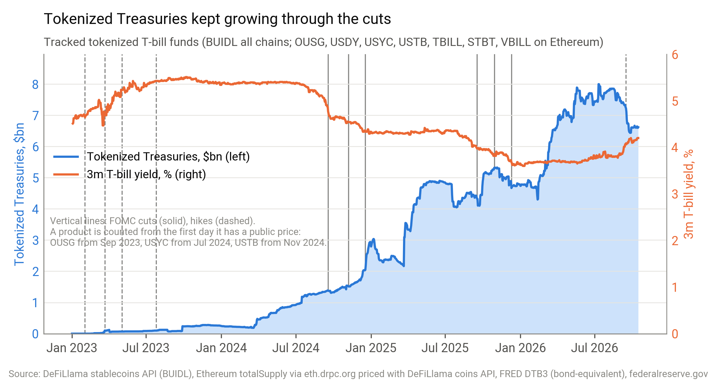
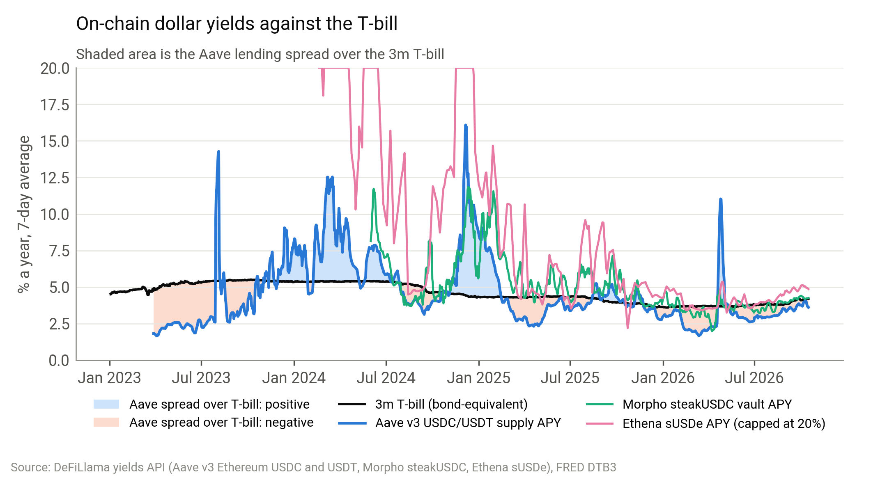
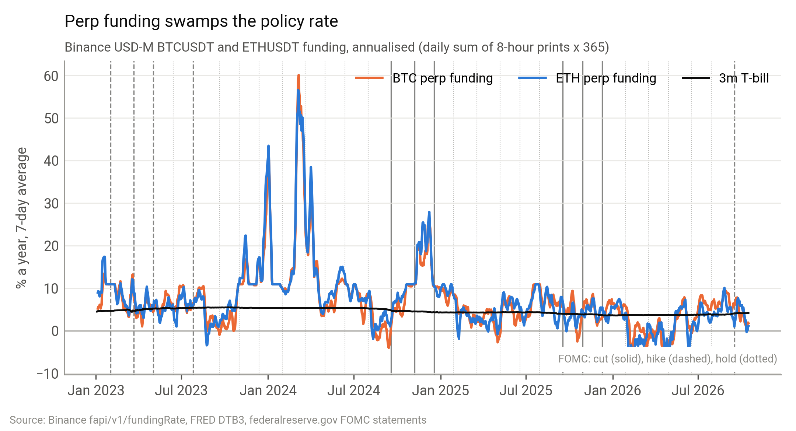
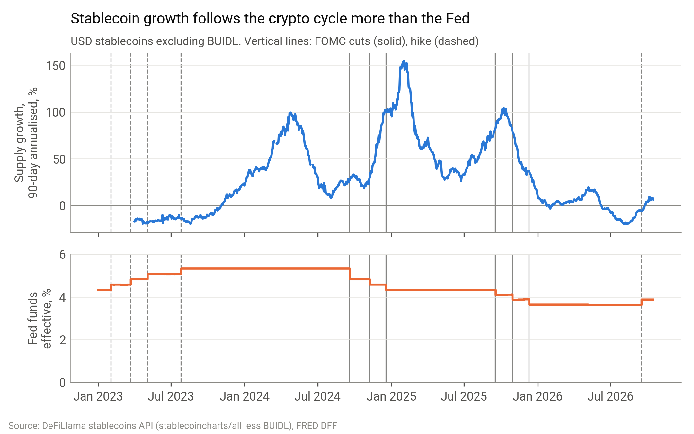
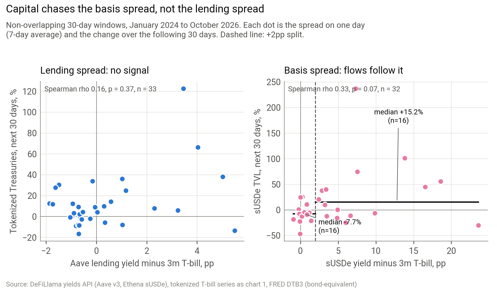

# Rate cuts didn't move on-chain dollars. Funding did.

*Macro to crypto note. Data to 16 October 2026.*

## Summary

- The Fed cut 175bp across 6 meetings, then hiked 25bp on 16 September 2026, and the bond market now prices more hikes, not cuts. Tokenized Treasuries grew through all of it, from $1.4bn the day before the first cut to $6.6bn today. Rate moves did not push money out.
- The spread between DeFi lending yields and T-bills tells you nothing about where money goes next. Months when DeFi lending paid well over T-bills were not followed by slower growth in tokenized Treasuries.
- The basis spread is different. When sUSDe paid more than 2pp over the 3m bill, sUSDe grew by a median 15.2% over the next 30 days. Below that line it shrank by 7.7%. My call: whatever the Fed does next, money stays in tokenized Treasuries. The only thing that pulls new capital into the basis trade is higher funding.

## The question

As the Fed cuts, does money leave tokenized T-bills and yield-bearing stablecoins for DeFi lending and basis trades? And at what spread over T-bills does that switch happen?

The last two years give a clean test. The upper end of the fed funds range came down 175bp from its 5.50% peak between 18 September 2024 and 10 December 2025. The Fed then held, and hiked by 25bp on 16 September 2026, leaving the range at 3.75% to 4.00%.

The cutting cycle is over, and the market expects it to reverse. On Treasury's curve for 15 October 2026, every maturity from 1 month to 2 years yields more than the 4.00% top of the policy range. The 1-month bill is 17bp above it, the 1-year 49bp and the 2-year 77bp. With effective fed funds at 3.88%, that is the market pricing further hikes. Some of the gap could be bill supply or term premium, but 77bp at two years is a hiking path. The next decision is due on 28 October 2026.

The 3m bill pays 4.20% on a bond-equivalent basis, the same as Treasury's published coupon-equivalent rate. That is only 67bp below the 4.87% it paid the day before the first cut. So the premise of the question, that rates keep falling, now runs against the market. I test what the cuts did, and the call below is built to hold if the next move is up.

## What the data shows

### Tokenized Treasuries grew through the cuts

The tracked tokenized Treasury total went from $1.4bn the day before the first cut to $6.6bn on 16 October 2026. On a like-for-like basis, counting only products priced on both dates, that is 4.3 times. The peak was $8.0bn in July 2026.

The tracked set covers 74% to 85% of what DeFiLlama shows for the same issuers across all chains since April 2026. That total is $8.7bn today.

The biggest single shift in the tracked set is USYC. Circle began issuing it natively on BNB Chain in July 2025, when Binance started accepting it as off-exchange collateral for institutional clients. USYC was $0.3bn the day before its first BNB Chain supply. It is $2.4bn now, 36% of the tracked total, and 98% of it sits on BNB Chain.

That growth came while rates were falling and the lending spread was mostly negative. It looks like collateral demand: a trader can post USYC as margin and still earn the bill yield. Demand of that kind follows derivatives activity, not the spread to DeFi lending. It is also the clearest case of tokenized Treasuries and the basis trade working together rather than competing.

Growth did not follow the level of rates. The correlation between the bill yield and trailing 30-day growth is 0.22 (p = 0.21, 34 windows). The rolling 180-day correlation between the lending spread and growth swung from -0.73 to 0.71 and was negative 43% of the time. That is noise, not a relationship.

### On-chain lending stopped paying a premium

Aave v3 USDC and USDT deposits beat the 3m bill on 69% of days in 2024, 35% in 2025 and 8% so far in 2026. Today Aave pays 3.61% against a bill at 4.20%, a spread of 0.59pp in the bill's favour. Morpho's Steakhouse USDC vault pays 4.25% and sUSDe pays 4.87%.

Stablecoin borrowing on Aave v3 Ethereum is $4.7bn, up from $2.4bn before the first cut. It has not been a steady climb. In the week to 24 April 2026, USDC and USDT deposits fell from $7.6bn to $3.7bn, a 51% drop, and supply rates spiked as the pools ran dry.

That followed the KelpDAO rsETH exploit on 18 April 2026. An attacker minted unbacked rsETH through KelpDAO's bridge, posted it on Aave as collateral and borrowed WETH against it. Aave froze its rsETH markets the same day. Stablecoin depositors then pulled out as fears of bad debt at Aave spread. It is the largest single move in my lending data, and it had nothing to do with rates.

### Funding sets the basis yield, not the Fed

BTC and ETH funding moves by tens of percentage points while the policy rate moves by quarters. FOMC days do not line up with the big swings. The 30-day average of BTC and ETH funding on Binance is 4.0% a year, 0.23pp below the bill.

That is why the basis trade has shrunk. sUSDe peaked at $6.2bn in September 2025 and is 81% smaller now, at $1.2bn.

### Stablecoins followed the crypto cycle

USD stablecoin supply (excluding BUIDL) rose from $170bn before the first cut to $303bn today, up 78%. The link to rates runs the wrong way for a simple cuts story. Supply grew faster when bills paid more, with a correlation of 0.41 between the bill yield and trailing growth (p = 0.02, 34 windows).

The likely reason is overlap: the high-rate period ran into the 2024 crypto rally, so rates and crypto demand are confounded in this sample. Forward growth also tracks the DeFi lending spread at 0.45 (p = 0.01, 33 windows), and that spread is a gauge of leverage demand. This data cannot separate the two. What it does not show is cuts driving stablecoin growth.

### Around the cuts themselves

I compared the 30 days before and after each of the 6 cuts. Tokenized Treasury growth slowed after 3 of them. Aave borrowing sped up after 4. Both happened together after only 2. The medians are no clearer: tokenized Treasuries grew 7.2% before and 9.7% after, while borrowing grew 7.1% before and fell 0.2% after. Six events with this much noise prove nothing.

### Where is the switch?

**Lending: no switch.** The lending spread does not predict tokenized Treasury growth: the correlation is 0.16 (p = 0.37, 33 windows). If falling rates pushed money from T-bills into DeFi lending, Aave borrowing should outgrow tokenized Treasuries when the lending spread is high. It does the opposite: the correlation is -0.34 (p = 0.05, 33 windows). Using BUIDL alone, which has the cleanest data, it falls to -0.13 (p = 0.50). I tested split points from -1pp to +2pp, and none gives a p-value below 0.51. The data does not support a lending threshold.

**Basis: a rough line at 2pp.** sUSDe flows do respond to sUSDe's own spread over the bill. Split at 2pp, sUSDe grew by a median 15.2% over the next 30 days above the line and shrank by 7.7% below it (16 windows each, p = 0.04).

It is not a clean step. Splits at 3pp and 4pp give medians of only 4.9% and 0.1% above the line. I also tried 7 split points, so a p-value of 0.04 would not survive a correction for that. I treat 2pp as a rough line, not a threshold. There is also a regime problem: in bull markets funding rises, which lifts both sUSDe's yield and its inflows, so the line may partly reflect market regime rather than investors reacting to the spread itself.

## The call

Over the next six months, money will not rotate out of tokenized Treasuries into DeFi lending, whether the Fed cuts or hikes. Money will move into the basis trade only when sUSDe pays more than 2pp over the 3m bill. Getting there takes higher funding, not lower rates. Today that spread is 0.67pp. If the market is right and the Fed hikes again, the bill leg rises and the bar for the basis trade rises with it.

The test, by 30 April 2027:

- The tracked tokenized Treasury total is above $6.6bn.
- While the sUSDe spread stays under 2pp, sUSDe stays at or below $1.2bn.
- If the spread holds above 2pp for a full month, sUSDe grows in the following month.

## What would prove me wrong

- The tokenized Treasury total falls below $6.6bn while Aave borrowing rises and the lending spread is still negative. That would mean money is leaving T-bills for lending after all.
- The sUSDe spread holds above 2pp for a month and sUSDe shrinks anyway. That would make the 2pp line noise.
- The tracked set misses the move. If issuers shift supply to chains I do not cover, a fall in my series could be migration, not redemption. USYC shows how fast supply can move between chains.

## Data and method notes

- **Rates:** FRED (DFF, DTB3, DFEDTARU) and Treasury's published bill rates and par yield curve. DTB3 is converted from a discount basis to a bond-equivalent yield so it compares with APYs. The conversion matches Treasury's 13-week coupon-equivalent rate to within 1bp on all 446 days where both are published. Weekend and holiday values carry the last published rate.
- **Events:** the KelpDAO exploit and USYC's BNB Chain launch are taken from public reporting and Circle's announcement, not from the data. The data only shows their timing. USYC: Circle, 24 July 2025, [USYC now supported as yield-bearing off-exchange collateral for Binance's institutional clients](https://www.circle.com/en/pressroom/circles-usyc-now-supported-as-yield-bearing-off-exchange-collateral-for-binances-institutional-clients). KelpDAO: [Aave's freeze notice](https://x.com/aave/status/2045593585966252377) and [CoinDesk, 20 April 2026](https://www.coindesk.com/tech/2026/04/20/aave-could-face-up-to-usd230-million-in-losses-after-kelp-dao-bridge-exploit-triggers-defi-chaos).
- **FOMC:** decisions are parsed from each statement on federalreserve.gov and checked against the FRED target range.
- **Tokenized Treasuries:** DeFiLlama's protocol endpoint returns no TVL history for these products, and its RWA API needs a paid key. I rebuilt the series from public data:
  - BUIDL from DeFiLlama's stablecoins API, across all chains.
  - OUSG, USDY, USTB, USYC, TBILL, STBT and VBILL from `totalSupply()` on Ethereum, plus USYC on BNB Chain, read daily from public archive nodes.
  - Each token valued at its DeFiLlama NAV price. A missing price is carried for up to 10 days, never filled beyond that.
  - Franklin BENJI, Spiko, WisdomTree and non-EVM chains are missing.
- **Lending:** Aave v3 Ethereum USDC and USDT supply APY from DeFiLlama. Borrowing is read from Aave's variable debt tokens on-chain.
- **Basis:** Ethena sUSDe APY and TVL from DeFiLlama's yields API. Funding is Binance USD-M BTCUSDT and ETHUSDT: the daily sum of 8-hourly prints times 365.
- **Spreads:** 7-day averages.
- **Tests:** run on non-overlapping 30-day windows from January 2024, after Aave's v2 to v3 migration. That gives 33 windows for lending and 32 for sUSDe. Correlations are Spearman. Split tests are one-sided Mann-Whitney.
- **Sample size:** with this few windows, a p-value near 0.05 is weak evidence.
- **Reproducing:** every figure in this note is printed against its computed value at the end of `analysis.py`. Sources and pull dates are in `data/SOURCES.md`.

<!-- figures:
cuts_total_bp=175, n_cuts=6, last_hike_bp=25, tt_at_first_cut_bn=1.4, tt_now_bn=6.6,
n_samp=33, corr.spread_lend_vs_tt_fwd.rho=0.16, corr.spread_lend_vs_tt_fwd.p=0.37,
threshold_susde[+2.0].above_pct=15.2, threshold_susde[+2.0].below_pct=7.7,
peak_upper=5.50, lower_now=3.75, upper_now=4.00,
tbill_now=4.20, ce_13w_on_curve_date=4.20, tbill_change_since_first_cut_bp=67, tbill_at_first_cut=4.87,
curve_1m_over_top_bp=17, curve_1y_over_top_bp=49, curve_2y_over_top_bp=77, dff_now=3.88,
date.curve_date=15 October 2026, date.next_fomc_decision=28 October 2026,
bey_check_max_diff_bp=1, bey_check_days=446,
usyc_before_bsc_bn=0.3, usyc_share_of_tt_pct=36, date.usyc_bsc_first=July 2025,
tt_growth_since_first_cut_x=4.3, tt_peak_bn=8.0, coverage_min_pct=74, coverage_max_pct=85, allchain_pools_bn=8.7,
corr.tbill_vs_tt_back.rho=0.22, corr.tbill_vs_tt_back.p=0.21, corr.tbill_vs_tt_back.n=34,
rollcorr_min=-0.73, rollcorr_max=0.71, rollcorr_share_neg_pct=43,
share_spread_pos[2024]=69, share_spread_pos[2025]=35, share_spread_pos[2026]=8,
lend_now=3.61, spread_lend_now=0.59, morpho_now=4.25, susde_now=4.87,
aave_borrow_now_bn=4.7, aave_borrow_at_first_cut_bn=2.4, aave_run_from_bn=7.6, aave_run_to_bn=3.7, aave_run_pct=51,
funding30_now=4.0, spread_funding_now=0.23, susde_peak_bn=6.2, susde_from_peak_pct=81, susde_tvl_now_bn=1.2,
sc_at_first_cut_bn=170, sc_now_bn=303, sc_growth_since_first_cut_pct=78,
corr.tbill_vs_sc_back.rho=0.41, corr.tbill_vs_sc_back.p=0.02, corr.tbill_vs_sc_back.n=34,
corr.spread_lend_vs_sc_fwd.rho=0.45, corr.spread_lend_vs_sc_fwd.p=0.01, corr.spread_lend_vs_sc_fwd.n=33,
n_events=6, ev_tt_slower_after=3, ev_borrow_faster_after=4, ev_both=2,
ev_tt_pre_median=7.2, ev_tt_post_median=9.7, ev_borrow_pre_median=7.1, ev_borrow_post_median=0.2,
corr.spread_lend_vs_rotation.rho=-0.34, corr.spread_lend_vs_rotation.p=0.05, corr.spread_lend_vs_rotation.n=33,
corr.spread_lend_vs_rotation_buidl.rho=-0.13, corr.spread_lend_vs_rotation_buidl.p=0.50,
threshold[-1.0].p=0.51,
threshold_susde[+2.0].n_above=16, threshold_susde[+2.0].n_below=16, threshold_susde[+2.0].p=0.04,
threshold_susde[+3.0].above_pct=4.9, threshold_susde[+4.0].above_pct=0.1,
spread_susde_now=0.67,
usyc_bsc_share_pct=98, usyc_now_bn=2.4,
price_carry_days=10, n_samp_susde=32,
date.first_cut=18 September 2024, date.last_cut=10 December 2025, date.last_hike=16 September 2026,
date.aave_run_end=24 April 2026, date.susde_peak=September 2025, date.tt_peak=July 2026,
date.last_date=16 October 2026, date.coverage_from=April 2026
-->
